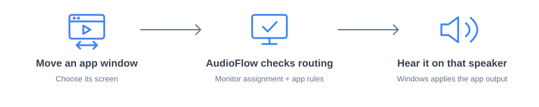
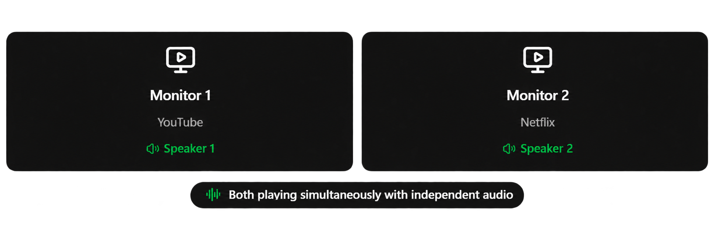

<p align="center"></p>

# AudioFlow

Your sound. Your screen. Automatically.

AudioFlow makes your app audio follow its screen. Assign speakers or headphones to each monitor, then move a supported app between displays and its sound follows automatically. Keep a video on one screen and music or calls on another, with each app using the output you choose.

Set rules for individual apps, test your speakers, and manage routing from the system tray. AudioFlow runs locally on Windows, with dark and light themes and signed updates.

[Download for Windows](https://github.com/hazavi/AudioFlow/releases/latest) · [Build guide](DEVELOPMENT.md) · [Validation](VALIDATION.md)


## Preview


_Interface illustration with sample names. The app displays real Windows devices and sessions._

## How it works



Assign an output to each monitor, then enable routing. AudioFlow runs in the tray and preserves manual Windows outputs by default. A switch is confirmed only after Windows reports the resulting audio session.



_Example with separate application audio processes. Browser tabs sharing an audio process share one output._

## Features

- Monitor output assignments and per-application routing rules.
- Speaker tests, activity history, and local configuration backup.
- Tray operation, Windows autostart, and dark/light/system themes.
- Signed GitHub updates with installation confirmation.

## Get started

1. Install the [Windows x64 release](https://github.com/hazavi/AudioFlow/releases/latest).
2. Choose and test an audio output for each monitor.
3. Enable automatic routing and move a supported audio app between screens.

Windows 11 is the primary target. Browser tabs sharing an audio process share an output. Some apps need playback restarted before a new preference takes effect. AudioFlow never changes the global Windows default output.

## Build from source

Requires Node.js 24, stable Rust, Microsoft C++ Build Tools, and WebView2.

```powershell
git clone https://github.com/hazavi/AudioFlow.git
cd AudioFlow
npm ci
npm run desktop
```

See the [development guide](DEVELOPMENT.md) for builds and tests, [release guide](docs/releases.md) for signing, and [validation record](VALIDATION.md) for tested behavior and remaining checks.

Local-first: no account, server, or telemetry. [MIT license](LICENSE) · [Third-party notices](THIRD_PARTY_NOTICES.md) · [Contributing](CONTRIBUTING.md)
