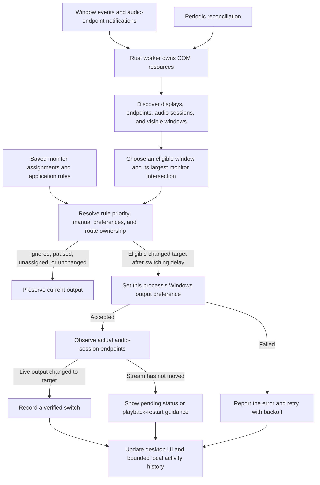

<p align="center"></p>

# AudioFlow

Your sound. Your screen. Automatically.

AudioFlow is a Windows desktop utility built with Tauri 2, Rust, React, and TypeScript. Assign a playback endpoint to a display and supported audio applications follow the monitor containing their window. It runs locally, including when its window is closed to the system tray.

[](https://github.com/hazavi/AudioFlow/actions/workflows/checks.yml)

[Releases](https://github.com/hazavi/AudioFlow/releases) · [Build instructions](DEVELOPMENT.md) · [Validation record](VALIDATION.md) · [Contributing](CONTRIBUTING.md)

## Interface preview


This is an interface illustration using sample device and application names, not a hardware-test screenshot. The desktop application displays data reported by Windows. Actual test results are recorded in [VALIDATION.md](VALIDATION.md).

## What it does

- Maps connected monitors to independently selected playback devices, including vertically arranged displays and negative desktop coordinates.
- Follows eligible application windows with a switching delay and overlap margin to avoid rapid switching at display boundaries.
- Supports fixed-device, follow-monitor, Windows-default, and ignore rules for individual executables.
- Preserves manual Windows output preferences by default and restores only routes AudioFlow still owns.
- Provides endpoint-specific speaker tests, activity history, local configuration import/export, and compatibility diagnostics.
- Runs in the system tray, supports Windows autostart, and offers dark, light, and system themes.
- Downloads signed updates from this repository after a signed release is published. Installation requires your confirmation.

## How audio moves between screens

For example, assign your built-in speakers to one display and an HDMI output to another. When a supported media player's window moves to the HDMI display, AudioFlow selects that monitor's assignment and requests a per-process output change. Other applications keep their own routes. Moving the player back requests the original display's output again.

AudioFlow checks the resulting audio sessions before recording a verified switch. A saved Windows preference that has not moved a live stream remains pending.



The engine runs independently of the selected UI page and continues while the window is hidden in the tray. It never implements routing by changing the global Windows default output.

## Run it

Published installers will be available under [GitHub Releases](https://github.com/hazavi/AudioFlow/releases). The local Windows build produces an NSIS installer in `src-tauri/target/release/bundle/nsis`. Normal use and installation are per-user and do not require administrator privileges. Microsoft WebView2 is required; the installer can bootstrap it if it is missing.

For development, install Node.js 24, stable Rust (1.90 or newer), and Microsoft C++ Build Tools with the Desktop development with C++ workload and Windows SDK. Then:

```powershell
git clone https://github.com/hazavi/AudioFlow.git
cd AudioFlow
npm ci
npm run desktop
```

This workspace also has an ignored, isolated Rust installation. Run `./scripts/desktop.ps1` to use it without changing your machine's PATH.

The isolated toolchain, local installers, build outputs, and private signing key are not part of a Git checkout. Install the prerequisites described in [DEVELOPMENT.md](DEVELOPMENT.md) when building on another machine.

## Use it

1. Complete setup and assign the intended output to each monitor. Use **Test** to play a short, quiet tone directly on that endpoint.
2. Enable automatic routing. Empty assignments leave applications alone.
3. Move an audio application's window between displays. AudioFlow waits for the switching delay and updates that process's output preference.
4. Use Applications or Routing Rules for fixed-device, follow-monitor, Windows-default, and ignore rules. Higher numerical priorities run first. An explicit rule grants AudioFlow control over that executable.
5. Close the window to keep routing in the tray. Use the tray menu to pause, scan, reopen, or exit.

Windows Volume Mixer preferences are preserved by default. If Windows changes a managed preference externally, AudioFlow releases that process until an explicit rule is saved or the process restarts. Pausing preserves current outputs. On exit, restoration only touches preferences AudioFlow still owns and processes whose creation identity still matches.

## What is verified

The native probe detected two real displays in a vertical arrangement, two playback endpoints, and real audio sessions on the development machine. An opt-in hardware test created two independent Windows MediaPlayer processes and verified their active audio sessions on separate physical endpoints. Moving a test window between displays and back produced the expected endpoint changes. The native UI also displayed real application routing events.

See [VALIDATION.md](VALIDATION.md) for the evidence and the checks that still need release testing.

## Audio limitations

- Routing uses internal Windows audio-policy interfaces behind `AudioRoutingProvider`. Windows updates can affect compatibility. Discovery remains available when routing is unavailable.
- An accepted output preference is different from a moved audio stream. AudioFlow counts a switch only after observing an active session on the requested output. Applications can require playback or stream recreation. The legacy `PlaySound` test did not follow the policy on this machine; the MediaPlayer test did.
- Browser tabs and windows sharing an audio process share one output. AudioFlow does not identify audible tabs. It uses the focused eligible window, then the last selected eligible window, then a deterministic largest-window fallback. It only climbs audio-process ancestors within the same executable.
- Applications that select a hardware endpoint themselves, exclusive-mode streams, protected processes, and some application frameworks may not follow persisted Windows preferences. AudioFlow does not inject code, stop applications, or change the global Windows default device.
- Display IDs are preserved. If Windows gives a display a different ID, its former assignment is retained as disconnected and requires a new manual assignment. Name-based suggestions require an unambiguous name match and your explicit selection.

## Updates

The official Tauri updater is integrated with stable-release checks, actual byte progress, signature verification, and a separate installation confirmation. A signing key was generated outside this repository; only its public key is included.

The updater is configured for [hazavi/AudioFlow](https://github.com/hazavi/AudioFlow). It reads the release's `latest.json` manifest, checks stable semantic versions, and verifies signed installer bytes and their signed version. Checks run after startup, every 12 hours, and on demand.

A GitHub repository by itself does not provide an update: a signed release, its manifest, and the CI signing secret must also be available. Follow [docs/releases.md](docs/releases.md) before publishing. The first local preview was built before the endpoint existed and needs a configured installer once. An installed older-version-to-newer-version upgrade remains unverified.

## Build and test

```powershell
npm run build
npm test
cargo test --locked --manifest-path src-tauri/Cargo.toml --lib
cargo check --locked --manifest-path src-tauri/Cargo.toml --all-targets
npm run tauri -- build --bundles nsis
```

The regular test suite covers routing decisions, ownership restoration, debounce, persistence, theme changes, and the update lifecycle. An opt-in native hardware test creates its own quiet audio processes and windows; it requires two physical displays and outputs. Pause other automatic routers before running it. See [DEVELOPMENT.md](DEVELOPMENT.md) for the command and [VALIDATION.md](VALIDATION.md) for results and untested scenarios.

## Project files

- `src-tauri/src/native/windows`: Core Audio discovery, policy ABI, display/window enumeration, event hooks, endpoint testing, and executable icons.
- `src-tauri/src/engine`: routing decisions, ownership, debounce, background reconciliation, and activity.
- `src-tauri/src/commands.rs`: typed desktop IPC operations.
- `src`: compact outlined UI, Zustand stores, theme provider, and shared updater service.
- `.github/workflows`: Windows checks and signed release pipeline with a draft validation gate.

There is no server, account, telemetry, database, or browsing-history collection. Configuration and bounded logs stay on the computer. Manual diagnostic exports include application names, executable paths, and device identifiers; they are copied or saved locally only when requested.

Licensed under [MIT](LICENSE). Third-party references and notices are in [THIRD_PARTY_NOTICES.md](THIRD_PARTY_NOTICES.md).
